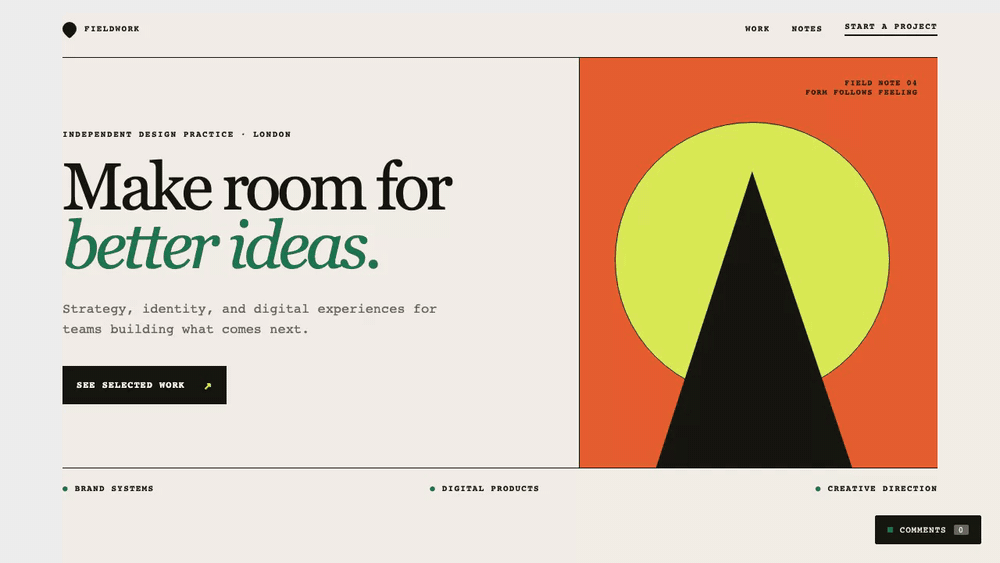

<h1 align="center">fidibaku</h1>

<p align="center"><strong>Website feedback your coding agent can act on.</strong></p>

<p align="center">
  Right-click any part of your UI. Leave a comment. Claude Code, Codex, or any file-reading agent can see it and make the change.
</p>

<br>

<p align="center">
  
</p>

<br>

## Start a review

For a running local website:

```sh
npx -y fidibaku review http://localhost:3000
```

For a static HTML page:

```sh
npx -y fidibaku review ./page.html
```

Right-click anywhere and type your feedback. Fidibaku saves it as `*.comments.md` and `*.comments.json` beside your project.

No account. No browser extension. No hosted service.

<br>

## Hand it to your agent

Tell Claude Code, Codex, or your agent of choice:

```text
Read the open Fidibaku comments, fix the UI, and mark each one resolved.
```

Each comment keeps the exact UI element, label, and context. Your agent gets actionable feedback instead of a paragraph describing where to look.

<br>

## Review any local UI

Landing pages, product interfaces, visual QA, HTML prototypes, generated reports, and design polish all use the same loop:

**Right-click → comment → agent acts.**

<br>

<p align="center">
  <a href="docs/architecture.md">How it works</a> ·
  <a href="SECURITY.md">Security</a> ·
  <a href="CONTRIBUTING.md">Contributing</a>
</p>

<p align="center">MIT</p>
